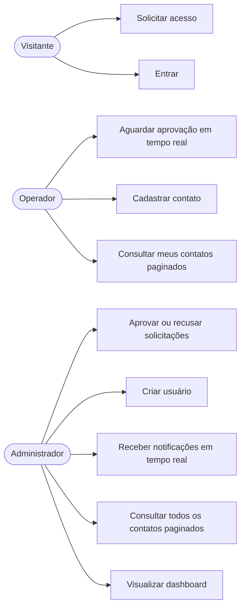
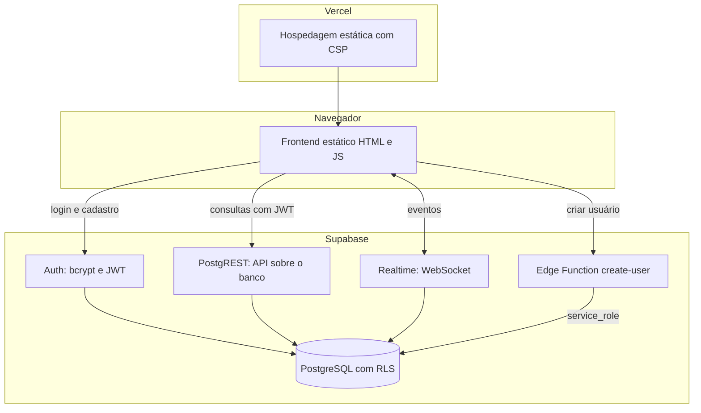
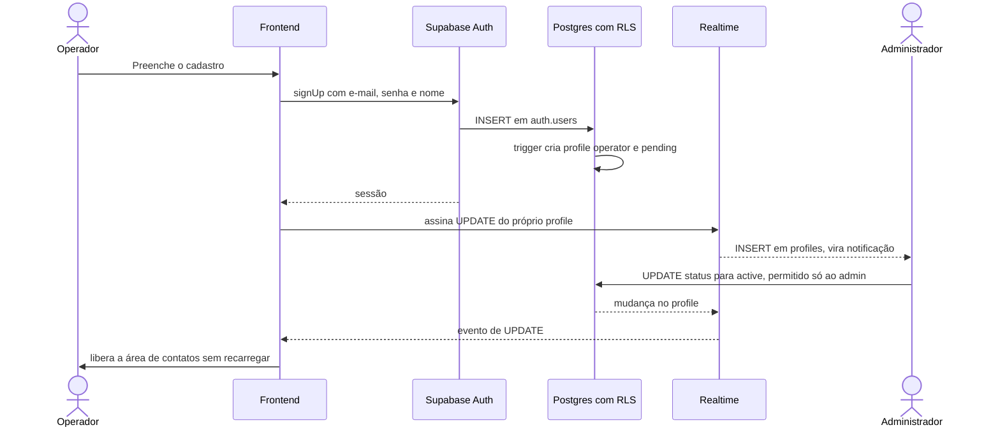
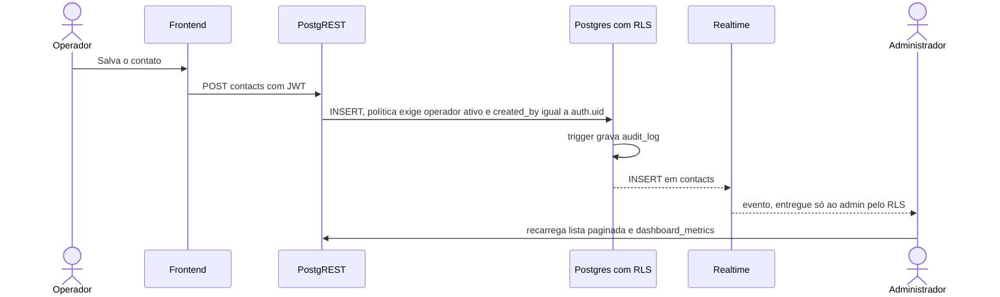
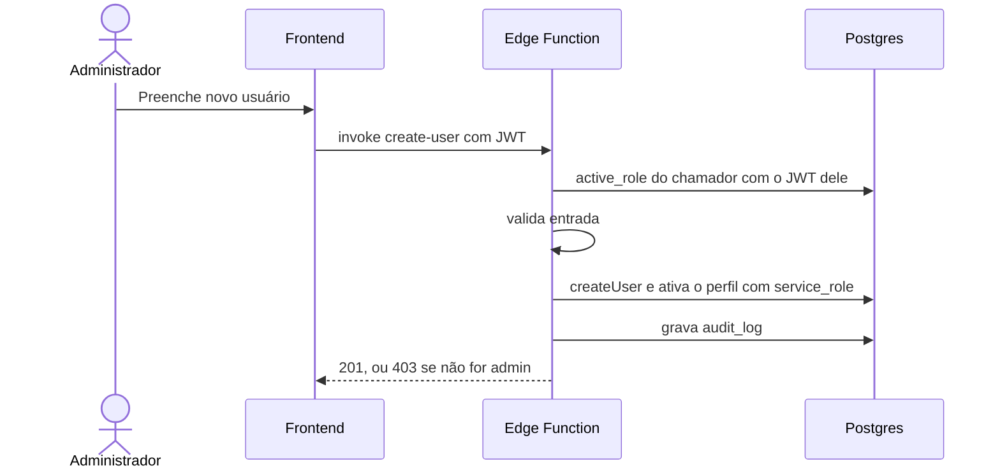
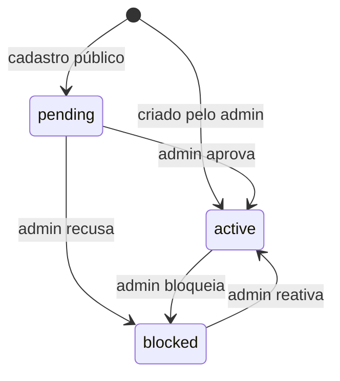
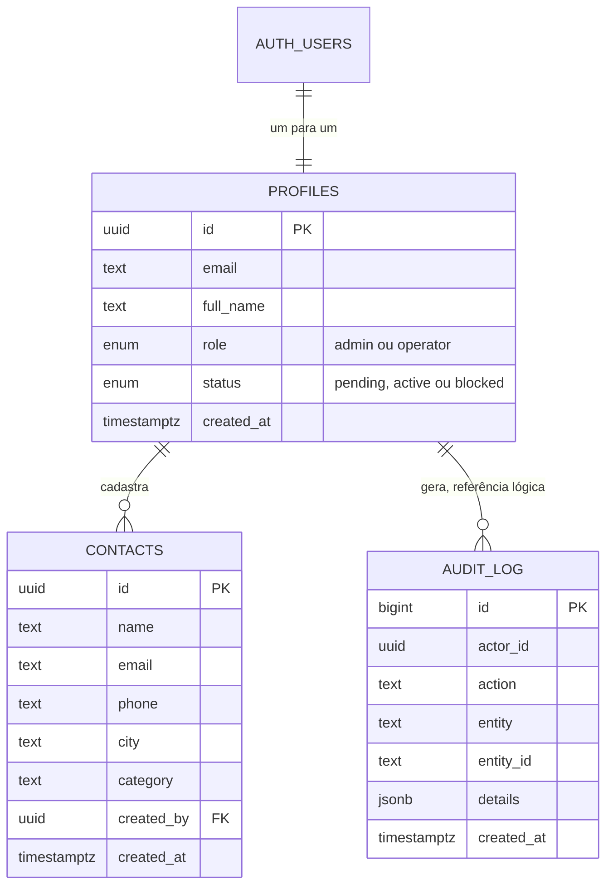

# Arquitetura e análise de requisitos

Os diagramas estão em Mermaid (renderizam no GitHub e em editores Markdown).

## 1. Atores

- **Visitante:** ainda sem conta; pode solicitar acesso e entrar.
- **Operador:** usuário aprovado que cadastra contatos.
- **Administrador:** aprova acessos, cria usuários, recebe notificações e vê o dashboard.

## 2. Requisitos

### Funcionais

| ID | Requisito | Estado |
|---|---|---|
| RF01 | Login com e-mail e senha | Implementado |
| RF02 | Visitante solicita cadastro; fica pendente até aprovação | Implementado |
| RF03 | Operador pendente vê a aprovação em tempo real, sem recarregar | Implementado |
| RF04 | Admin aprova ou recusa solicitações | Implementado |
| RF05 | Admin cria usuários (operador ou admin) já ativos | Implementado |
| RF06 | Operador cadastra contatos | Implementado |
| RF07 | Cada contato novo notifica o admin em tempo real | Implementado |
| RF08 | Listas de contatos paginadas no backend (operador: próprios; admin: todos) | Implementado |
| RF09 | Dashboard do admin com métricas em tempo real | Implementado |
| RF10 | Admin analisa a atividade (auditoria) | Parcial: gravada no banco; falta a tela |
| RF11 | Admin lista, bloqueia e reativa usuários | Parcial: regra no banco; falta a tela |

### Não funcionais

| ID | Requisito | Como é atendido |
|---|---|---|
| RNF01 | Segurança de autenticação e autorização | Supabase Auth, RLS, grants por coluna, CSP |
| RNF02 | Tempo real | Realtime (WebSocket) filtrado por RLS |
| RNF03 | Escalabilidade de consultas | Índices e paginação no banco |
| RNF04 | Manutenibilidade | Migrations versionadas, ADRs, regras de acesso em código SQL |
| RNF05 | Auditabilidade | `audit_log` alimentada por triggers |
| RNF06 | Implantação simples | Vercel + Supabase, sem servidor próprio |

## 3. Casos de uso

## 4. Visão de containers

## 5. Sequências

### 5.1 Cadastro e aprovação em tempo real

### 5.2 Cadastro de contato e notificação

### 5.3 Criação de usuário pelo admin

## 6. Estados do usuário

Somente o estado `active` dá acesso a dados. Bloqueio e reativação já são permitidos pelo RLS; a tela correspondente está no roadmap.

## 7. Modelo de dados

## 8. Ameaças e mitigações

| Ameaça | Mitigação | Risco residual |
|---|---|---|
| Elevação de privilégio no cadastro | Papel e status por trigger; sem `user_metadata` na autorização; grants por coluna | Baixo |
| Acesso indevido a dados de outros (IDOR) | RLS em todas as tabelas, avaliado a cada requisição | Baixo |
| Uso de conta pendente ou bloqueada | `active_role()` exige status ativo | Baixo |
| Vazamento da `service_role` | Só existe na Edge Function, como segredo do ambiente | Baixo |
| Força bruta e credential stuffing | Senha longa, erro genérico e limites de taxa do Supabase Auth | Médio: faltam CAPTCHA e 2FA |
| XSS | Sem `innerHTML`, CSP restritiva | Médio: token acessível ao JS da página |
| CSRF | Autenticação por cabeçalho `Authorization`, não por cookie | Baixo |
| Enumeração de e-mails no cadastro | Mensagens genéricas no login | Médio: o cadastro pode revelar e-mails existentes |
| Cadastros em massa | Aprovação manual do admin | Médio: faltam CAPTCHA e limite por IP |
| Dependência de CDN | Versão fixa do supabase-js | Médio: roadmap Vite com bundle local |

## 9. Escalabilidade e manutenibilidade

**Gargalos prováveis, em ordem, e o caminho de cada um**

1. **Paginação por OFFSET:** índice em `created_at` hoje; paginação por cursor em volumes altos.
2. **Dashboard:** agregações recalculadas a cada evento; evoluir para visão materializada ou cache com atualização por job.
3. **Realtime:** limite de conexões por plano; evoluir para canais de broadcast ou fila de eventos, mantendo o RLS.
4. **Banco:** réplicas de leitura e pool de conexões gerenciado quando a leitura dominar.
5. O frontend estático escala por CDN, sem servidor de aplicação a dimensionar.

**Manutenibilidade e processos**

- Esquema e regras de acesso versionados em `supabase/migrations` (revisáveis em pull request).
- Decisões registradas em `docs/DECISOES.md`.
- Próximos passos de processo: CI com lint, testes SQL (pgTAP) para as políticas RLS, testes E2E (Playwright), ambientes separados (dev e produção) e geração de tipos a partir do esquema.
